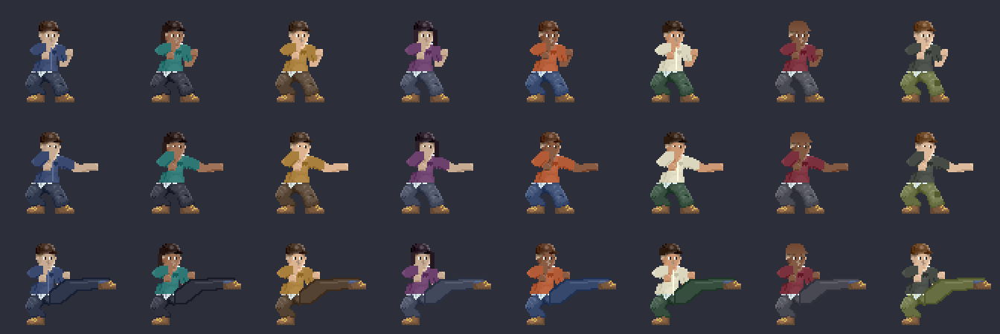

# Generic campaign fighters

Eight unnamed opponents are implemented in `assets/characters/generic_01.ron` through `generic_08.ron`. The numbers are internal asset identifiers; their displayed names are empty. They appear only as campaign opponents, outside the character-selection carousel.

## Campaign sequence

Every playable level starts with two different generic fighters, followed by its existing rival. The last level of each campaign has three generic fighters before its rival (Galata Tower, Asen's Fortress and High Castle).

Press Enter after a preliminary victory to face the next opponent. Each encounter is a normal match with fresh health and round scores. Defeat allows a retry against the current opponent. Returning to the map and re-entering with the same fighter resumes the current sequence. Choosing another fighter or leaving for the title starts a new sequence. Squares below each level circle show completed fights in green, the next fight in gold and remaining fights in gray; normal levels have three squares and final levels have four. Only beating the real rival records completion and unlocks the next level. Existing saved completions are preserved.

## Combat

All eight have identical health, speed and attack timing:

- Light: straight punch, 26 damage, 5 startup frames.
- Heavy: front kick, 44 damage, 10 startup frames.
- Both attacks have crouching and airborne variants.
- No special attack, ground slam, weapon, projectile, summon or passive power.
- Ordinary walking, jumping, blocking and rolling remain available.

## Artwork



The sprite sets copy body and boot pixels from `tools/katmata.png` and reuse the existing pose and arm construction in `tools/gen_katmata.py`. Plain clothing, hair details and palette changes distinguish the eight variants. Cigarettes, the pack, shirt emblem and other character props are omitted.

Each set contains 48 transparent 84 x 63 PNG frames, aligned to the game's existing body centre and floor line, plus a 40 x 40 portrait. All editing stays on the original pixel grid; no smoothing or AI resampling is used. These share the existing character's proportions and animation construction, rather than the varied builds proposed in the initial written concepts.

| Variant (internal only) | Clothing palette | Hair detail |
| --- | --- | --- |
| 01 | Navy and dark slate, light shirt seam | Short brown |
| 02 | Teal and charcoal | Dark tied-back hair |
| 03 | Ochre and brown | Short brown |
| 04 | Plum and slate | Dark bob |
| 05 | Rust and blue | Brown |
| 06 | Cream and forest green, light shirt seam | Brown bun |
| 07 | Burgundy and gray | Shaved head |
| 08 | Charcoal and olive, cargo pocket | Swept brown |

Regenerate sprites, portraits, character data and this preview with:

```sh
python tools/gen_generic_fighters.py
```

Generated paths: `assets/sprites/generic_01/` through `generic_08/`, `assets/portraits/generic_01.png` through `generic_08.png`, and `docs/generic-fighters-preview.png`.
